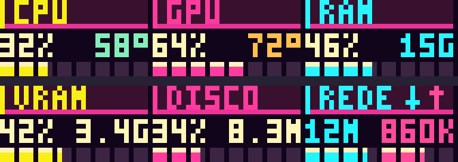
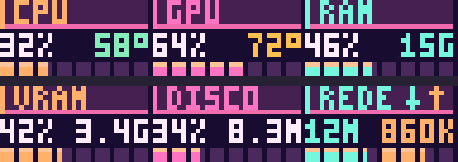

# iPixel Monitor 96×16

Transforma um painel LED **iPixel Color 96×16** em um monitor de hardware do Windows. Um script Python lê as métricas do PC, desenha quadros coloridos e os envia ao painel por Bluetooth Low Energy (BLE).

**Tela principal** · Uso de CPU, GPU e RAM, temperaturas de CPU e GPU e quantidade de RAM em uso.


**Tela de detalhes** · Uso de VRAM, atividade e taxa de leitura e gravação do disco, download em ciano e upload em âmbar.


As prévias usam valores ilustrativos. Por padrão, cada tela fica visível por cerca de **8 segundos**. A cada **2 segundos**, o monitor lê os sensores e envia um novo quadro se os pixels da tela visível mudaram. A conexão é mantida durante a execução e refeita se cair. Os quadros são temporários.

## Requisitos

- Windows 10 ou 11 com um adaptador Bluetooth Low Energy habilitado.
- [Python 3.11 ou mais recente](https://www.python.org/downloads/windows/). A configuração foi validada com Python 3.12 de 64 bits.
- Painel compatível com o protocolo **iPixel Color**. O layout padrão usa **96 colunas × 16 linhas**.
- As bibliotecas do [requirements.txt](requirements.txt) cuidam da conexão BLE, do protocolo iPixel e da renderização dos quadros.

Os sensores NVIDIA e as fontes de temperatura da CPU são opcionais. O monitor funciona com as métricas disponíveis e mostra traços quando um sensor está indisponível.

## Onde encontrar o painel

[Painel LED iPixel Color no AliExpress](https://s.click.aliexpress.com/e/_c4plsUqV)

Para usar um painel iPixel Color de outro tamanho, você pode pedir a uma IA para adaptar o código. Informe a largura e a altura em pixels e peça para ajustar as dimensões dos quadros, a distribuição das métricas e a verificação da resolução em `monitor_ipixel.py`.

## Instalação

Abra o PowerShell na pasta do projeto. Se preferir, baixe o ZIP pelo menu **Code → Download ZIP** do GitHub e abra o PowerShell na pasta extraída.

```powershell
git clone https://github.com/ebonato/iPixel-Monitor.git
cd iPixel-Monitor
python -m venv .venv
.\.venv\Scripts\python.exe -m pip install -r requirements.txt
```

## Encontrar e testar o painel

1. Ligue o painel perto do PC e desconecte o aplicativo do celular, se ele estiver conectado.
2. Procure os painéis próximos. O comando lista nomes Bluetooth e endereços sem abrir uma conexão.
3. Copie o endereço do seu painel e substitua o endereço ilustrativo nos comandos de teste e de execução.

```powershell
.\.venv\Scripts\python.exe .\monitor_ipixel.py --scan
.\.venv\Scripts\python.exe .\monitor_ipixel.py --address 02:00:00:00:00:01 --once
.\.venv\Scripts\python.exe .\monitor_ipixel.py --address 02:00:00:00:00:01
```

Use **Ctrl+C** para encerrar. O arquivo `monitor-ipixel.cmd` também pode ser usado no lugar de `python.exe monitor_ipixel.py`. Ele procura primeiro o Python de `.venv` e depois no PATH. A variável de ambiente `IPIXEL_PYTHON` permite indicar outro executável.

## Parâmetros

| Parâmetro | Comportamento e padrão |
| --- | --- |
| `--address ENDEREÇO` | Endereço BLE do painel. Obrigatório para enviar quadros. |
| `--scan` e `--scan-seconds N` | Busca de dispositivos LED próximos. Duração padrão de 8 s. |
| `--interval N` | Intervalo de leitura em segundos. Padrão de 2 s. |
| `--page auto\|principal\|detalhes` | Alterna as telas ou fixa uma delas. Padrão `auto`. |
| `--page-seconds N` | Tempo em cada tela no modo automático. Padrão de 8 s. |
| `--theme padrao\|cyberpunk\|gta-vi` | Aparência das duas telas. Padrão `padrao`. |
| `--disk D:` | Unidade monitorada. Por padrão, usa a unidade do Windows. |
| `--gpu-index N` | Índice da GPU NVIDIA no `nvidia-smi`. Padrão de 0. |
| `--dell-cpu-sensor ID` | Lê primeiro o sensor térmico do firmware Dell. Opcional e desativado por padrão. |
| `--pawnio` | Usa o PawnIO com os módulos preparados pelo projeto. Opcional e desativado por padrão. |
| `--pawnio-modules PASTA` | Usa o PawnIO com módulos de uma pasta informada manualmente. |
| `--lhm-url URL` ou `--no-lhm` | Endereço JSON do LibreHardwareMonitor ou desativação da consulta. Padrão `http://127.0.0.1:8085/data.json`. |
| `--once` | Envia um quadro e encerra. Com `--page auto`, envia a principal. |
| `--preview ARQUIVO.png` e `--preview-page principal\|detalhes` | Gera um PNG de 768×128 com as métricas do PC, sem conexão Bluetooth. Padrão `principal`. |
| `--log-file CAMINHO` | Grava eventos em arquivo com rotação. Útil com `pythonw.exe`. |

Exemplo com atualização a cada 3 segundos, alternância a cada 12 segundos e leitura da unidade D.

```powershell
.\monitor-ipixel.cmd --address 02:00:00:00:00:01 --interval 3 --page-seconds 12 --disk D:
```

## Temas

Use `--theme` para mudar as cores das duas telas. Sem esse parâmetro, o monitor usa o tema padrão mostrado no início deste README.

**Cyberpunk** · Amarelo elétrico, magenta e ciano.



**GTA VI** · Rosa, pêssego e turquesa sobre fundo violeta.



```powershell
.\monitor-ipixel.cmd --address 02:00:00:00:00:01 --theme cyberpunk
.\monitor-ipixel.cmd --theme gta-vi --preview gta-vi.png --preview-page detalhes
```

Para escolher o tema na inicialização automática, acrescente `--theme cyberpunk` ou `--theme gta-vi` aos argumentos do Agendador de Tarefas.

## Métricas e dependências opcionais

| Fonte | Métricas |
| --- | --- |
| Windows | Uso de CPU e RAM. Tempo ativo da unidade lógica e taxa combinada de leitura e gravação. Download e upload agregados nas interfaces Ethernet e Wi-Fi físicas ativas. |
| NVIDIA `nvidia-smi` | Uso e temperatura da GPU e uso de VRAM. Use `nvidia-smi -L` para conferir o índice. |
| Firmware via AWCC WMI | Temperatura do sensor térmico interno da CPU em computadores que expõem a interface AWCC WMI. |
| PawnIO | Leitura direta de **CPU Package** em Intel x64. Leitura **Tctl** em AMD Zen x64 disponível para teste. |
| LibreHardwareMonitor | Temperatura da CPU. Quando disponível, pode suprir uso e temperatura da GPU que o `nvidia-smi` não fornecer. |

No disco e na rede, **B**, **K**, **M** e **G** indicam bytes, kB, MB e GB por segundo. As barras de rede usam uma escala logarítmica para mostrar tráfego leve. Nos valores de memória, **G** e **T** representam GiB e TiB. As cores da temperatura mudam aos 70 °C e aos 85 °C.

### Temperatura da CPU pelo firmware via WMI

Em computadores que expõem a interface térmica **AWCC WMI**, o monitor pode obter a temperatura pelo WMI nativo do Windows, diretamente em Python. Essa fonte dispensa o LibreHardwareMonitor, o servidor HTTP e o PawnIO. A disponibilidade da interface e o ID do sensor dependem do firmware. O valor representa o sensor do firmware e pode diferir de **CPU Package**, que é uma leitura do processador.

Abra um PowerShell como administrador na pasta do projeto e instale a dependência opcional:

```powershell
.\.venv\Scripts\python.exe -m pip install -r requirements-dell.txt
.\monitor-ipixel.cmd --address 02:00:00:00:00:01 --dell-cpu-sensor 1 --no-lhm
```

Substitua o endereço pelo do painel e confirme qual ID corresponde à CPU no seu computador antes de ativar a opção. A interface é descrita na [documentação do kernel Linux sobre Dell AWCC WMI](https://docs.kernel.org/wmi/devices/alienware-wmi.html).

### Temperatura da CPU pelo PawnIO

Em hardware compatível, o monitor lê a temperatura pelo driver [PawnIO](https://pawnio.eu/). Abra um terminal como administrador na pasta do projeto e execute a preparação uma vez. O script baixa os arquivos oficiais, verifica os hashes SHA-256, valida a assinatura do instalador e abre a instalação do driver quando ele estiver ausente. O Windows ainda requer a confirmação do instalador. Se o driver já estiver instalado, o script o reutiliza. Os módulos ficam em `Program Files\iPixel-Monitor\PawnIO-Modules`.

```powershell
.\.venv\Scripts\python.exe .\preparar_pawnio.py
.\monitor-ipixel.cmd --address 02:00:00:00:00:01 --pawnio --no-lhm
```

O monitor escolhe o módulo pelo fabricante do processador. Para usar arquivos já extraídos do [pacote oficial de módulos assinados](https://github.com/namazso/PawnIO.Modules/releases), use `--pawnio-modules PASTA` no lugar de `--pawnio`. O modo `--download-to PASTA` do script salva o instalador e os dois módulos verificados para uso offline.

A leitura Intel foi validada em hardware Intel x64. A opção AMD lê **Tctl**, que é a temperatura de controle e pode diferir de **Tdie**. Ela ainda precisa de validação em hardware AMD. [Documentação de Tctl e Tdie](https://docs.kernel.org/hwmon/k10temp.html)

### Temperatura da CPU pelo LibreHardwareMonitor

1. Abra o [LibreHardwareMonitor Windows Forms](https://github.com/LibreHardwareMonitor/LibreHardwareMonitor#nightly-builds) como administrador. Instale o PawnIO pelo próprio programa se ele solicitar. Confirme que o sensor **CPU Package** (Intel) ou **CPU (Tctl/Tdie)** (AMD) mostra um valor.
2. Em **Options → Remote Web Server → IP/Port**, selecione **127.0.0.1**, mantenha a porta **8085** e ative **Run**. A seleção explícita de localhost foi adicionada após a versão 0.9.6. [Alteração no LibreHardwareMonitor](https://github.com/LibreHardwareMonitor/LibreHardwareMonitor/pull/2579)
3. Abra `http://127.0.0.1:8085/data.json` no navegador para conferir se o sensor aparece no JSON. O iPixel passa a mostrar a temperatura quando a leitura fica disponível.

Para iniciar a coleta com o Windows, ative **Run On Windows Startup** e **Start Minimized** no LibreHardwareMonitor.

## Iniciar no logon sem janela

No **Agendador de Tarefas**, crie uma tarefa para o seu usuário com o gatilho **Ao fazer logon**. Em **Geral**, selecione **Executar somente quando o usuário estiver conectado**. Configure a ação **Iniciar um programa** com estes valores.

| Campo | Exemplo |
| --- | --- |
| Programa/script | `C:\Projetos\iPixel-Monitor\.venv\Scripts\pythonw.exe` |
| Argumentos | `monitor_ipixel.py --address 02:00:00:00:00:01 --log-file monitor.log` |
| Iniciar em | `C:\Projetos\iPixel-Monitor` |

Troque o caminho e o endereço pelos da sua instalação. Em **Configurações**, remova o limite de duração da tarefa e escolha **Não iniciar uma nova instância** se ela já estiver em execução. Se usar notebook, revise as condições de energia para permitir a execução na bateria. Clique em **Executar** na tarefa para testar. O `monitor.log` deve registrar a conexão e a alternância entre telas. Para parar o monitor, encerre a tarefa pelo Agendador.

Com WMI Dell ou PawnIO, use **Executar com privilégios mais altos**. Instale o executável, as bibliotecas, os scripts e os módulos usados pela tarefa elevada em um diretório protegido contra gravação por usuários comuns, como `Program Files`.

## Solução de problemas

- **Nenhum painel encontrado.** Ative o Bluetooth, aproxime o painel, desligue o Bluetooth do celular por um instante e tente `--scan --scan-seconds 15`.
- **O painel aparece, mas a conexão falha.** Encerre outras instâncias do monitor ou aplicativos que possam estar conectados ao painel. Reinicie o painel e confira o endereço detectado.
- **A temperatura da CPU fica em traços.** Com Dell ou PawnIO, confira os privilégios e o log. No modo Dell, confirme o ID térmico. No modo PawnIO, confira o driver e a pasta dos módulos oficiais. Com o LibreHardwareMonitor, confira o sensor e o JSON local. Se usar outra porta, informe a URL com `--lhm-url`.
- **GPU ou VRAM ficam em traços.** Confira se `nvidia-smi -L` lista a GPU desejada e se o índice informado está correto. A VRAM é lida via `nvidia-smi`.

## Estrutura

- [monitor_ipixel.py](monitor_ipixel.py) organiza a leitura de sensores, renderiza os quadros e gerencia a conexão BLE.
- [windows_io.py](windows_io.py) consulta os contadores nativos de disco e rede.
- [dell_temperature.py](dell_temperature.py) lê o sensor térmico do firmware Dell via WMI.
- [pawnio_temperature.py](pawnio_temperature.py) lê a temperatura da CPU pelos módulos assinados do PawnIO.
- [preparar_pawnio.py](preparar_pawnio.py) baixa e verifica os arquivos oficiais para o modo PawnIO.
- [monitor-ipixel.cmd](monitor-ipixel.cmd) inicia o script no Windows e repassa seus argumentos.
